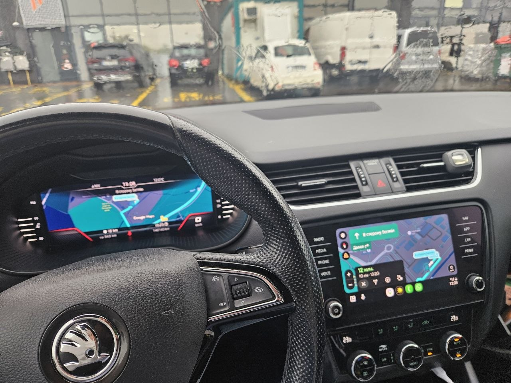
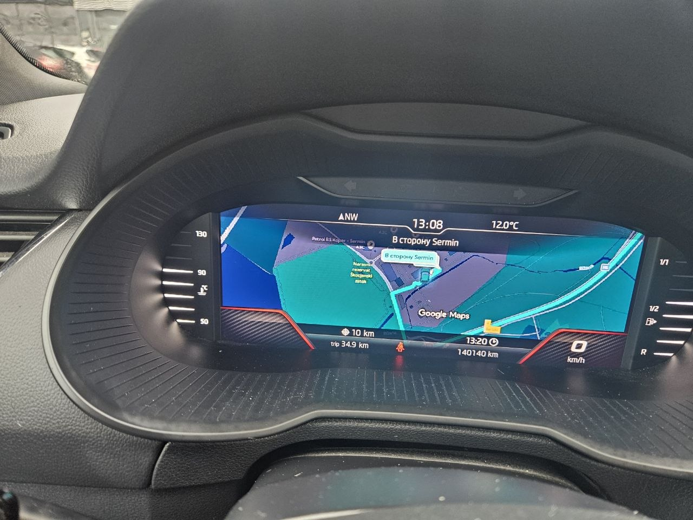
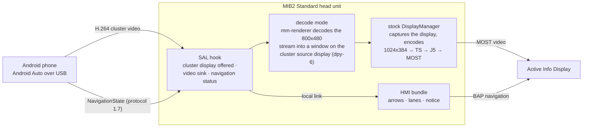

# mst2-cluster-nav-android-auto

### Google Maps or Waze from Android Auto, right in your instrument cluster

**The phone's map in the Virtual Cockpit's own navigation view, and the cluster's own turn
arrows driven by the phone's route.**
For VW Group cars with a **MIB2 Standard** head unit (TechniSat/Preh, "MST2") and the
**Active Info Display / Virtual Cockpit**. A fork of
[mst2-cluster-nav](https://github.com/perkthefox/mst2-cluster-nav) by Anton Perk, which does
the same for CarPlay; this fork adds **Android Auto**.

 

### ☕ Enjoying the map in your cluster? Buy me a coffee

This is a free, non-commercial hobby project — no ads, nothing locked behind a paywall.
If it earned a place on your dashboard, a coffee keeps the next feature coming.

### [**❤️ Support this project on Ko-fi → ko-fi.com/webbug**](https://ko-fi.com/webbug)

 

  

Škoda Octavia III (facelift), Amundsen MIB2 STD, firmware P0478T, Samsung Galaxy S23 over USB — the first car this was verified on (November 2026).

---

## How to use

You need: a **MIB2 Standard navigation unit** (e.g. Škoda Amundsen) with the **Virtual Cockpit**,
firmware `MST2_EU_SK_ZR_P0478T` or `P0480T` (the installer refuses any other build; to see yours,
long-press **MENU** → **Software Update**), an **SD card**, and an **Android phone** with Google Maps
or Waze on a USB cable.

**Everything is in one download.** The release zip is a ready SD card: the
[MIB STD2 Toolbox](third-party/mib-std2-pq-zr-toolbox/UPSTREAM.md) (v1.5.1, MIT, unmodified) with
this mod already merged in.

### How to open the Green Engineering Menu (GEM)

Used in several steps below. On the unit: **long-press the MENU button → Testmode → Green
Engineering Menu.** To leave it, press **MENU** again. If "Testmode" has no such entry, GEM is
not enabled yet: it is switched on once with an OBD2 tool in the infotainment adaptation
(control unit 5F, developer mode); see the [Toolbox guide](third-party/mib-std2-pq-zr-toolbox/README.md).

### Steps

1. **Download** [**mst2-cluster-nav-android-auto-sd-v1.0.zip**](https://github.com/webbug-dev/mst2-cluster-nav-android-auto/releases/latest).
2. **Prepare the card.** Format an SD card as **FAT32** and unzip the download to its **root**, so
   that `custom/`, `toolbox/`, `install.sh` and `metainfo2.txt` are directly on the card.
3. **Install the Toolbox on the unit** (skip this step if the Toolbox is already installed; check:
   GEM shows an entry "MIB STD2 Toolbox"). Ignition on, put the card into the **SD1** slot, long-press
   **MENU → Service Mode → Software Update**, and install **MIBStd2_Online_Approval**. Wait until it
   finishes and the unit restarts.
4. **Upload the mod's menu to the unit.** Card in the slot, open GEM, then
   **MIB STD2 Toolbox → Customization → GreenMenu → "Copy custom Green Engineering Menu screens
   and scripts to unit"**. When it is done, press **MENU** to leave GEM.
5. **Open GEM again.** A new entry **Cluster_Navigation** is now under **Customization**
   (if you do not see it, repeat step 4).
6. **Install (trial).** **Customization → Cluster_Navigation → "Install / update: the NEXT boot
   only"**, then restart the unit (ignition off and on, or hold the power knob).
7. **Try it.** Connect the phone by USB, start a route in Google Maps or Waze, and switch the
   cluster to its navigation view (the **VIEW** button on the steering wheel). The phone's map
   appears between the dials, with the cluster's own arrows and ETA.
8. **Keep it or remove it.** Open GEM → **Customization → Cluster_Navigation** → **"Enable
   permanently: every boot"** to keep it, or **"Uninstall"** and restart to go back to stock
   (a backup of the stock files stays in `mst2-cluster-nav-backup/` on the card).

Troubleshooting, the update procedure and the expert menu: [docs/INSTALL.md](docs/INSTALL.md).

---

## What you get

| | |
|---|---|
| **The phone's map on the cluster** | With an Android phone connected over USB, Google Maps (or Waze) draws its cluster map and the Active Info Display shows it in its own **Navigation** view, where the built-in navigation's map would be. |
| **Native turn arrows** | Turn arrows, the approach bar, distance and time to the destination and the current street come from the phone's route and are drawn **by the cluster itself**, with the same graphics as for the built-in navigation. Lane guidance from the phone becomes the cluster's own lane symbols where the app sends it. |
| **No "navigation on mobile device" screen** | While the phone owns the cluster, the notice the stock unit shows during phone guidance stays away. |
| **CarPlay too** | Everything the original project does for CarPlay is still in: the CarPlay cluster map, arrows and lanes. |

## Verified on

| | |
|---|---|
| **Car** | Škoda Octavia III (A7) facelift with the Active Info Display (Continental, 10.25", `5E0920790A`) |
| **Head unit** | Amundsen MIB2 Standard, **navigation** build, firmware `MST2_EU_SK_ZR_P0478T`, HMI `H29.319.93` |
| **Phone** | Samsung Galaxy S23, wired Android Auto, Google Maps |
| **Date** | 2026-11-10, live route on the road |

The original project's reference firmware `MST2_EU_SK_ZR_P0480T` (HMI `H29.319.120`) passes the
installer as well; its Android Auto path was not run in a car. The installer refuses other HMI
builds, and every native part checks the firmware it hooks and stays stock on a build it was
not verified on. Radio units without navigation (Bolero) are not supported: they have no SAL
process and draw no cluster map.

## How it works

The stock unit already encodes its own cluster map as H.264 and sends it to the cluster over
MOST. This fork puts the phone's map into that picture:

1. **A second display for the phone.** SAL, the process that drives Google's Android Auto
   receiver library, is given a few extra endpoints through `LD_PRELOAD`: a video sink for a
   *cluster* display (800x480), the input source such a display needs, and a navigation status
   service. The service discovery answer is rewritten on its way to the phone so that the phone
   sees the cluster display and starts streaming its map to it.
2. **Decode mode.** The cluster's decoder takes only the stock 1024x384 geometry, and the phone
   cannot send it. So the phone's stream is not handed to the cluster: it is decoded on the head
   unit by a second mm-renderer context of our own (the way the unit decodes the phone's main
   video) into a window on the cluster source display, cropped to the centred 800x300 band. The
   stock DisplayManager captures that display and sends the cluster its usual 1024x384 stream;
   nothing after the encoder changes.
3. **Native arrows.** The phone is asked for Android Auto protocol 1.7 and sends its route as
   `NavigationState` / `NavigationCurrentPosition`. The maneuver, distances, time and street go
   over a local link to a small HMI bundle, which writes them where the built-in navigation
   writes its own; the cluster draws its own arrows and lane symbols from them, and the
   "navigation on the mobile device" notice is held back while the phone owns the cluster.

Details: [docs/ANDROID-AUTO.md](docs/ANDROID-AUTO.md) (the Android Auto side and the decode
mode), [docs/ARCHITECTURE.md](docs/ARCHITECTURE.md) (the whole mod: principles, fail-safes,
CarPlay path), [docs/MANEUVERS.md](docs/MANEUVERS.md), [docs/LANES.md](docs/LANES.md).

## Built to fail safe

Whatever happens, the unit falls back to stock, never to a black screen. Nothing of the firmware
is replaced: three text lines in three files are added (and removed again by Uninstall), plus
the mod's own directories.

| | |
|---|---|
| **Trial boot** | After every install the mod loads **once**. Only you make it permanent. |
| **SD-card kill switch** | A card with an empty file `mst2-cluster-nav-disable` keeps the mod out before the HMI starts and turns every hook off within two seconds. |
| **Self-repair guard** | Runs before every HMI start; a missing library, an HMI restart before the mod settled, or a conflicting patch, and the mod takes itself out, telling you why. |
| **Crash guards** | Every native part notices if it took its process down and switches itself off. |
| **Build checks** | On any firmware build the mod was not verified on, it changes nothing and stays stock. |
| **Atomic edits + backups** | The three touched files are written atomically, with stock copies on the unit **and** on your card (`mst2-cluster-nav-backup/`). Uninstall restores them byte for byte. |

## Status and limitations

- **Verified:** decode mode with the live Google Maps map and the native arrows on P0478T
  (2026-11-10). Decode mode is the default and the only path that works on this firmware.
- **Map only.** The cluster shows the phone's map, route and car marker. Android Auto's cluster
  display has no maneuver card of the app on it; the arrows come from the cluster itself.
- **No speed limit sign** from the phone: the Android Auto protocol carries no speed limit for the
  cluster display.
- **"Google Maps" logo.** Google Maps draws its logo at the bottom edge of the content area it
  is given. The content insets offered to the phone (top 90, bottom 0, left/right 300 for the
  800x480 stream) put that edge at the bottom of the visible 800x300 band, so the logo falls out
  of the picture and the car marker sits about 65 % down the band (measured on the car,
  2026-11-10).
- **No steering-wheel zoom** of the phone's cluster map: there is no such command in the Android
  Auto protocol for the cluster display (CarPlay has one).
- **Dark theme** only is requested from the phone; a day/night switch is on the
  [roadmap](docs/ROADMAP.md).
- **Pass-through mode** (the phone's stream handed to the cluster as it is, the original
  project's CarPlay path) is kept in the expert menu as the old experimental path for Android
  Auto; on this firmware it gives a **black cluster**, because the phone can only send 800x480 or
  1280x720 and the cluster's decoder takes only 1024x384.
- The **built-in cluster map must stay on** underneath (the default): DisplayManager captures the
  cluster display only while that map redraws.

## Building from source

`sh package.sh` builds the three native libraries (clang + ld.lld, no QNX SDK), the HMI bundle
(JDK 8, against a `MIBHMI.jar` converted from **your own unit's** `MIBHMI.jxe`, which is
proprietary and not part of this repository) and lays out the SD card content in
`build/sd/custom/`. See **[docs/BUILD.md](docs/BUILD.md)** for the toolchain, the host checks
and reproducibility. The ready-built content for P0478T is in [release/](release/README.md).

## Support

This is a non-commercial hobby project (CC BY-NC-SA 4.0): nothing is sold and nothing is
unlocked by paying. If it made your drives better and you want to say thanks, a coffee at
**[ko-fi.com/webbug](https://ko-fi.com/webbug)** is appreciated.

## Credits

- **[mst2-cluster-nav](https://github.com/perkthefox/mst2-cluster-nav)** by **Anton Perk**: the
  CarPlay cluster map, the native arrows and lanes, the installer, the fail-safes and the
  research into this firmware that this fork is built on. The original project was developed
  and tested in **mQbEMU**, an emulator of VW MQB head units and instrument clusters running
  their unmodified firmware.
- **mst2-altscreen-carplay** (GPL-3.0-or-later): knowledge used, no code copied. The decode mode
  follows what that project measured in a car on the sister firmware P0480T (a second
  mm-renderer context beside the stock one, `overlay=0`, a window one pixel narrower than the
  display, never destroying a window DisplayManager still has on its list). Its documentation is
  cited in `native/src/sal/decode.c`; none of its code is part of this work.

## Licence

This repository is an adaptation of mst2-cluster-nav, Copyright (c) 2026 Anton Perk, licensed
under **[CC BY-NC-SA 4.0](LICENSE)**. Changes were made: an Android Auto branch was added (SAL
hooks around the Android Auto receiver library, the cluster video sink and navigation status
service, protocol 1.7 navigation, the decode mode with its own mm-renderer context and Screen
window on the cluster source display, the HMI counterpart for the Android Auto notice, a
diagnostic stream capture, the expert and release GEM menus, the P0478T firmware verification).
The adaptation is released under the same licence; see [NOTICE](NOTICE).

Free for non-commercial use, sharing and adaptation with attribution to **Anton Perk**, a link to
the [original repository](https://github.com/perkthefox/mst2-cluster-nav) and a statement of
the changes made; adaptations under the same licence. Selling builds or "paid versions" is not
permitted.

This repository contains no vendor firmware, binaries or map data. Use at your own risk:
modifying a head unit may void its warranty.
